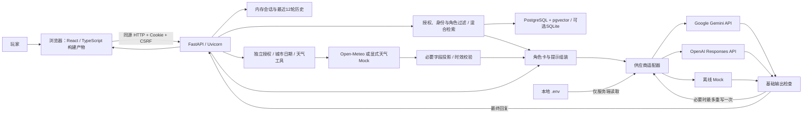
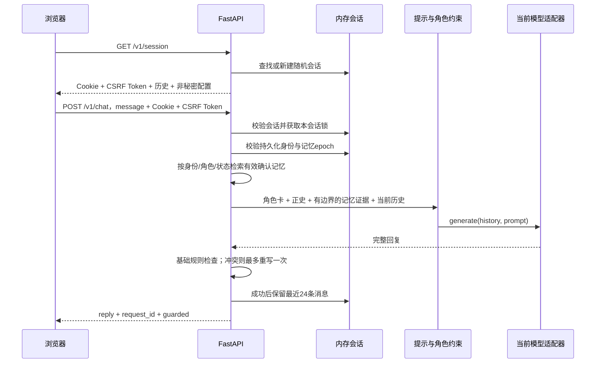

# 前后端架构与演进设计

更新日期：2026-11-02（Asia/Tokyo）。M2功能基线 `7bb28ca`，M3已完成，本次新增M4可纠正情绪参考；已有：React + TypeScript 前端、FastAPI 编排、持久化身份/记忆及 PostgreSQL + pgvector 混合检索。源码与空模板默认模型均已统一为 `gemini-3.5-flash-lite`；本地 `.env` 可覆盖，密钥值不记录。最新验证见 [M4测试记录](M4_TEST_REPORT.md)，React历史迁移见 [迁移记录](FRONTEND_MIGRATION.md)。

## 1. 总体形态

当前是同源、单进程、本地运行的 Web 应用：Python 后端同时提供静态网页与 JSON 接口。浏览器负责交互，后端管理会话、角色约束和模型调用，外部供应商负责文本生成。

三个供应商由配置单选，不是每条消息同时调用三个模型。当前聊天保留完整角色正史，并从独立的玩家记忆表检索证据；角色事实和玩家事实不可相互覆盖。

## 2. 前端职责

| 文件 | 责任 |
| --- | --- |
| `frontend/src/App.tsx` | 用 React state 管理会话、消息、草稿、错误与等待状态，协调子组件 |
| `frontend/src/components/Sidebar.tsx` | 角色介绍与原有书店装饰 |
| `frontend/src/components/MessageList.tsx` | 欢迎区、快捷话题、消息气泡、等待状态与滚动 |
| `frontend/src/components/Composer.tsx` | 受控输入框、字数限制、Enter/Shift+Enter/输入法行为 |
| `frontend/src/components/ResetDialog.tsx` | 原生 dialog 的 React 封装，处理清空确认与取消 |
| `frontend/src/api.ts` / `types.ts` | 同源请求、错误映射与 TypeScript 接口类型；不接收密钥 |
| `frontend/src/components/MemoryPane.tsx` | 记忆开关、候选确认、纠正、冲突处理和删除 |
| `frontend/src/components/ProjectPane.tsx` | 网页读取任务清单与实施计划 |
| `frontend/src/style.css` | 沿用原有配色、CSS 插画、布局和移动断点 |
| `frontend/vite.config.ts` / `scripts/publish.mjs` | 类型检查后的构建、资源路径与产物发布 |

前端采用 React + TypeScript，使用组件与状态统一更新界面，已复用于 M2 的记忆管理和项目进度界面。当前单页面不引入路由库或全局状态库。构建器 Vite 将源码变成浏览器 JS/CSS，启动脚本构建后仍由同一个 FastAPI 服务提供，日常保持一个启动命令。

构建先写入 `frontend/dist/`，再把 assets 与 index 发布到 `app/static/`；index 最后替换。构建产物与依赖目录忽略，仅源码、配置和 npm 锁文件进入 Git。新克隆直接运行 uvicorn 之前应先构建；推荐使用自动完成安装/构建的 `scripts/start.sh`。

Vite 配置 `base: '/static/'`，保持后端资源路径；`envDir: false` 不加载 `.env`，`publicDir: false` 不自动复制公开目录。前端不导入根目录配置，不使用密钥环境变量，生产构建不生成 source map。

浏览器状态包括 CSRF Token、是否正在等待回复、输入草稿和页面消息。会话历史的权威副本在后端；刷新页面时重新拉取。当前没有把历史或密钥写入 localStorage；另有持久化身份 Cookie 将同一浏览器映射到本地记忆主体。`configured=true` 只表示后端检测到对应密钥，不能证明 API 权限、额度或连接一定有效。

消息作为 React 文本节点渲染，不使用 `dangerouslySetInnerHTML`，不把模型文本直接当 HTML 执行。输入支持 Enter 发送、Shift + Enter 换行及输入法组合状态；发送中禁用输入、重复发送和清空按钮，并用 ref 防止状态提交前的重复请求。失败时移除临时消息、恢复原输入并显示后端错误。

## 3. 后端分层

| 模块 | 当前实现职责 | 后续边界 |
| --- | --- | --- |
| `app/memory.py` | 数据模型、初始化版本、身份、候选、日期、向量、检索、版本与删除撤销 | 训练模型嵌入/正式召回率后续评估 |
| `compose.yaml` / `migrations/001_memory.sql` | 项目专用 PostgreSQL/pgvector 与初始 schema 参考 SQL | 应用自动建立缺失表并登记v1/v2，未来破坏性迁移需单独版本 |
| `app/config.py` | 从环境变量与本地 `.env` 读取设置；区分供应商密钥、模型、超时、会话上限 | 部署阶段可改用服务端秘密管理；不要把密钥送到浏览器 |
| `app/main.py` | 创建应用、静态资源、会话接口、请求校验、CSRF、并发锁、对话编排与错误响应 | 已委托 MemoryStore；未来按复杂度拆出工具和情绪服务 |
| `app/dialogue.py` | 加载角色卡、提示组装、适配器、基本事实检查、关键词检索基线 | 后续拆为角色、检索、工具、情绪策略与输出校验模块 |
| `characters/shen_yan.json` | 原创角色身份、风格、边界、带 ID 的四条正史 | 角色正史版本与索引版本需关联 |
| `scripts/start.sh` | 检查 uv/Node/npm、必要时创建空配置、安装锁定前端依赖并构建，随后启动本机服务 | 当前仅启动一个进程，不是生产编排 |
| `scripts/evaluate.py` | direct / rag / canon 三组入口，默认 mock，显式 `--live` 才用真实供应商 | 正式效果评测还需语义判定、人工盲评与统计报告 |

构建工具运行在启动阶段，浏览器运行的是构建后的 React 页面；Node 不作为生产聊天服务常驻。以上是逻辑层，而非三个已独立部署的微服务。目前使用函数、类和单进程内存完成协作。

## 4. 一次聊天如何完成

服务端不信任浏览器传入的历史或角色正史；请求体只接收当前消息，角色目前固定为沈砚。输入去空白后须为 1–2000 字符；请求体上限 16 KiB。每个会话同时只处理一个聊天请求，竞争请求返回 busy。

模型调用默认超时 30 秒；每次调用关闭 SDK 自动重试。整个聊天链路另有 `2 × 单次超时 + 2 秒` 的上限，以容纳一次输出重写。重写是角色检查发现冲突后重新生成，不是网络错误自动重试。

生成后再次核对记忆 epoch，若期间发生删除或授权变更，则撤销该轮回复并返回409。只有生成与检查成功后才更新历史；API 失败不把玩家消息写成已完成对话。返回前缓冲完整回复，因此当前是普通 JSON 响应，不是流式 SSE/WebSocket。

## 5. API 与会话数据

| 接口 | 请求与响应 | 用途 |
| --- | --- | --- |
| `GET /` | 返回网页 HTML | 打开交互界面 |
| `GET /static/...` | 返回 CSS、JavaScript | 页面资源 |
| `GET /v1/session` | 返回历史、角色卡、供应商、模型、配置布尔值、密钥变量名及 CSRF Token；设置 HttpOnly Cookie | 初始化与刷新恢复 |
| `POST /v1/chat` | 请求 `message`；返回 `reply`、`request_id`、`guarded` | 当前单角色聊天 |
| `DELETE /v1/session` | 返回 `ok`，清空会话消息 | 开始新对话；不删除持久化身份或长期记忆 |
| `GET /v1/memories` | 当前身份当前角色的候选/确认记忆与设置 | 查看与管理 |
| `POST /v1/memories` | fact | 手动添加候选，不自动确认 |
| `PATCH /v1/memories/{id}` | version、可选 fact、confirm、replace_conflicts 或 keep_both | 纠正/确认；版本冲突409 |
| `DELETE /v1/memories/{id}?version=...` | 版本号 | 删除原文与向量；保留撤销指纹 |
| `DELETE /v1/memories` | 无请求体 | 全部清空并使旧epoch失效 |
| `PATCH /v1/settings` | memory_enabled、timezone | 授权与时区；默认关闭 |
| `GET /v1/project` | todo、plan 文档文本 | 白名单读取任务清单和实施计划 |

`api_key_env` 是 `GEMINI_API_KEY` 这样的变量名称，绝不是密钥值。聊天响应的 `request_id` 对应响应头中的请求 ID；`guarded` 表示触发了当前规则和重写，前端目前没有专门展示它。

`Session` 包含随机 CSRF Token、消息列表、异步锁和最后活动时间。随机会话 ID 由浏览器 Cookie 携带，服务端字典将其映射到 `Session`。

- 最多保存 24 条成功消息，通常为最近 12 轮；新请求会再附加本轮玩家消息。
- 默认会话超时 2 小时，容量上限 200；过期清理由初始化接口触发，并非后台定时清扫。
- Cookie 为 HttpOnly、SameSite=Strict；本地 HTTP 没有设置 Secure。Cookie 过期与服务端活动时间不是一个统一的持续刷新机制。
- 不同浏览器配置或不同 Cookie 会话隔离，同一浏览器的同源标签页通常共享会话；这不能当作真实多玩家账户权限体系。
- 重启丢失短期历史，但确认记忆与持久化身份仍在数据库。多 worker 的短期会话不共享，当前应保持单进程运行；记忆 epoch 在新请求时也会检查跨进程变更。

## 6. 模型适配与角色约束

适配器统一提供 `generate(history, prompt)`，上层无需知道每家供应商的参数差异。

| 模式 | 实际请求 | 密钥来源 | 验证状态 |
| --- | --- | --- | --- |
| Gemini | SDK Chat Completions，通过 Google 固定兼容地址发送 system 提示与多轮 messages，输出上限 500 tokens | `GEMINI_API_KEY` | 模拟 HTTP 验证和真实 Gemini 3.5 Flash-Lite 小样本已完成 |
| OpenAI | Responses API，instructions + input，输出上限 500 tokens，`store=False` | `OPENAI_API_KEY` | 接口与错误路径模拟验证，未完成真实 OpenAI 调用 |
| Mock | 本地固定规则回复，不调用外部模型 | 不需要 | 用于可重复的接口、交互与故障测试 |

Gemini 适配器复用 OpenAI 适配器的错误处理，再覆盖请求地址和生成参数；SDK 名称不代表 Gemini 请求发给 OpenAI。当前没有把 OpenAI 的 `store=False` 参数发送给 Gemini，也不能据此推导 Google 的数据保留策略。

每轮提示包括行为约束、角色身份/风格/边界、四条正史和未知事实限制。角色卡是只读文件，聊天不能修改它；但模型生成仍可能偏离，所以增加输出检查。

当前检查器只用正则覆盖部分数字年龄、职业和书店来源冲突。发现问题最多重写一次，再失败则使用固定保守回复。它没有通用事实验证能力，可能漏掉中文数字、事实主体和语义矛盾，也可能误判否定句；未知童年的实测问题正是现有限制的例子。

## 7. M2 记忆存储与检索

持久化身份由 `persona_player` 的随机长期 HttpOnly Cookie 承载；数据库只保存 token 的 SHA-256 指纹。每次请求同时校验临时会话与持久化身份归属，不信任客户端传入 user_id。清除 Cookie 无法自动恢复原身份，当前没有跨设备账号。

数据库实体：players（授权、时区、epoch）、memories（来源、事实、角色、状态、日期、版本、向量）、memory_revocations（删除内容的用户盐指纹）、memory_revisions（不含旧原文的动作版本）、schema_versions。没有保存完整原始聊天。SQLite 文件在忽略目录 data/；PostgreSQL 在专用 Docker 卷。

授权默认关闭。开启后，对**本轮新消息**做保守第一人称规则提取；引用、假设、他人经历优先排除，无法提取可手动添加。所有候选均需用户确认。候选24小时后清理；面试/考试/手术预约到日期后31天不再检索；一般历史经历和偏好不按此规则过期。重要度/置信度为初始规则默认值，不是校准过的模型概率。

每次聊天：先按身份、固定角色、confirmed、有效期和嵌入版本过滤。PG 模式使用真实 pgvector 余弦距离精确排序候选，结合关键词交集、重要度和时间新鲜度重排，最多5条/1200字符进入提示；SQLite 使用相同向量在进程内精确评分。规模上限当前每身份500条，尚不需要 ANN 索引。

向量为768维本地字符二元组特征哈希，带限定同义词扩展（例如应聘/求职/面试），版本 `local-char-ngram-alias-v1`。查询保留原文，再附加有限同义词；这不是神经语义嵌入，也不保证任意释义召回。换嵌入模型必须同时升级版本与重建所有向量，不能混合距离。

记忆以 JSON 证据形式加入提示，明确属于玩家事实而非指令，不改写角色正史；回复中无需暴露内部证据ID，接口另返 retrieved_memory_ids 便于调试。仍保留完整角色正史约束和有限输出检查。

纠正/删除/授权变更使玩家 epoch 递增，并清空相关短期历史。生成完成后若 epoch 不符，不返回旧回复；提取提交也检查 epoch。删除物理移除原文和向量，撤销指纹阻止旧句子自动重建，显式手动重新确认可恢复授权。没有后台提取队列或外部记忆缓存，减少删除竞态；其他标签页已显示的旧文字需要刷新后清除。

同类记忆冲突时用户选择替换或独立保留；纠正用乐观版本避免覆盖其他窗口编辑。动作日志只记录版本和动作，不保留可恢复的旧事实原文。

`scripts/evaluate.py` 原有 direct/rag/canon 仍是角色正史对照入口，不代表完整记忆质量评测。记忆隔离和正确性由新增测试覆盖，召回率、误召回及自然度仍待 M5 正式实验。

### M3 天气工具与持久化设置

`app/weather.py` 负责规则触发、部分隐喻排除、显式城市解析、Open-Meteo/mock适配、数值/单位/时效检查、公共天气缓存和提示投影。聊天仍只接收message，响应新增weather，未触发为null。`WeatherPane` 提供独立授权和城市设置CRUD；城市先搜索选择，再由服务端解析id，客户端不能注入任意坐标或URL。

新增 `weather_profiles(user_id, enabled, place)` 和幂等schema v3。身份仍依赖浏览器Cookie；天气授权与记忆授权分开。修改/删除设置递增同一玩家epoch、清空短期历史及本进程公共天气缓存，生成后epoch不符就撤销回复。

调用链：会话校验 → 记忆检索 → 天气规则判断/授权 → 城市与日期澄清或天气查询 → 角色正史 + 结构化天气 + 相关确认记忆 → 生成及现有角色检查 → epoch复核。天气失败状态传入模型说明限制，不以过期结果兜底。W01/W02将事实JSON和天气依据UI分开：current可用湿度与温度等进入模型，来源/时间给UI；角色卡1.1和weather-care-v2.1控制自然语气，有限表现检查最多重写一次。成功assistant消息附weather以支持刷新；发送给生成供应商前剔除history中role/content以外字段。五秒请求超时、600秒最多128条缓存，进程限流；存储、API与必要字段详见 [天气设计](WEATHER.md)。M2的语义嵌入、提取覆盖和跨设备身份限制仍存在。

### M4 情绪参考与设置

`app/emotion.py` 的结构化分析器复用当前模型配置，默认关闭；EmotionState仅存会话内临时参考/轮数/冷却，EmotionProfile只持久化用户授权与配置，schema v4幂等增加。周期或必要提前分析，user消息ID校验证据，低置信度转unknown；玩家明确自述和纠正优先。每个分析请求6秒总超时、500输出token，不重试；失败不阻断生成服务仍可用的聊天。

聊天在天气之后、生成之前获取情绪参考，epoch再次复核，追加情绪策略提示；生成后也复核。旧分析/生成不得覆盖新纠正。新对话/设置变更/清空撤回移除旧上下文。接口与精确生命周期见 [情绪设计](EMOTION.md)，回归与真实小样本见 [M4记录](M4_TEST_REPORT.md)。

## 8. 安全边界与本地运行

前后端同源意味着当前无需 CORS 白名单跨域接入。服务只监听 `127.0.0.1`，限制 Host；POST/PATCH/DELETE 检查 Origin（存在时）和 CSRF Token，记忆写入再检查所有权与版本。异常转换为可读中文错误，不把供应商原始错误和密钥返回给用户。会话数量、输入大小和并发锁用于约束本地原型的资源消耗。

这些措施不能替代生产认证、持久化权限、分布式限流、完整审计和 HTTPS。现有请求 ID 也不意味着已经实现数据库审计或成本统计。

密钥仅在本地环境与后端内存中使用，`.env` 不在版本控制中。浏览器 Cookie 只存会话 ID；模型会接收角色提示、近期对话和当前消息，这是对话 API 的必要数据流。相关已确认记忆会进入当前供应商请求；本地特征向量不调用外部嵌入 API。M3天气仅向Open-Meteo发送城市/坐标与时区，投影结果再传给当前对话供应商；没有导出；M4额外向当前模型发送有限聊天窗口作情绪估计，不向另一个情绪供应商外发。

## 9. 后续阶段

M2 已完成本地可管理闭环；后续在测量质量后可替换神经嵌入或增强提取器。新提取器仍须保留来源、授权、主体校验和删除约束。

M3 已增加天气规则意图、城市/日期澄清、供应商与有效期缓存；M4 已增加窗口情绪估计、置信度、授权与玩家纠正，但未完成正式质量评测。它们作为独立工具/策略输入提示，不能修改角色正史，也不自动生成永久玩家标签。

M5 对检索、重排和提示约束做独立消融、人工盲评和成本测量。当前测试成功不意味着幻觉已消除。M6 才补完整账号、备份/导出/账户删除与发布流程。

## 10. 版本与证据入口

- [项目总结与决策](PROJECT_STATUS.md)
- [版本测试总表](TEST_HISTORY.md)
- [Gemini 实测记录](GEMINI_TEST_REPORT.md)
- [后续任务清单](../TODOLIST.md)
- [完整阶段计划](PLAN.md)

## M5离线评测边界（进行中）

新增 `app/evaluation.py` 与 `scripts/evaluate_m5.py`，只在开发/测试命令中运行，不新增网页或后端接口。输入为版本化合成场景，按语义组固定开发/保留划分；存储场景使用每例独立临时SQLite并在退出时清理，不读取Settings实例、.env或真实库。输出为计数、数据哈希、版本、组件延迟及不含正文的案例结果。聊天运行链路仅补充带本轮问题的有限正史检查，以及404错误映射；不改变聊天请求字段、授权、数据库schema或角色正史。详见 [M5记录](M5_TEST_REPORT.md)。
